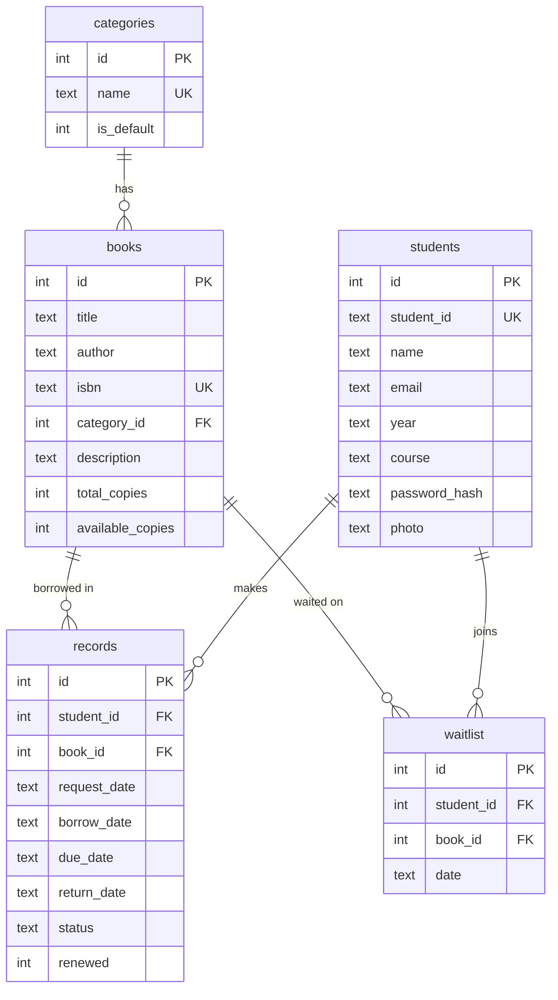

# UPHSD Molino Library Management System

A library management system for the **University of Perpetual Help System DALTA – Molino Campus** (class project).

**v4 moves all data out of the browser and into a real SQL database** (SQLite) behind a small Node.js + Express API, so the book collection can grow to hundreds of thousands of titles without slowing down. The front end (HTML/CSS/vanilla JS) is the same UI as before.

## Quick start

Requires **Node.js 18 or newer** (https://nodejs.org).

```bash
npm install        # one time
npm start          # starts the server
```

Then open:

- Students: <http://localhost:3000>
- Admin: <http://localhost:3000/admin.html> — username `admin`, password `library123`

The database file is created automatically at `data/library.db` on first run and is pre-loaded with the 8 sample books. Stop the server with `Ctrl+C`; your data stays in that file.

> Don't double-click the `.html` files any more — they need the server to reach the database (a banner will tell you if you do).

Optional settings (environment variables): `PORT` (default 3000), `ADMIN_USER`, `ADMIN_PASS`, `DATA_DIR` (where `library.db` lives).

## "What if the books become many?" — demo it

```bash
npm run seed:bulk              # adds 100,000 generated books
npm run seed:bulk -- 500000    # …or 500,000
npm run seed:clear             # removes only the generated ones
```

Restart nothing — just refresh the page. Browse, search and filter stay instant because:

| Technique | Where | Why it matters |
|---|---|---|
| **Server-side paging** (12 books per page) | `GET /api/books?page=…` | The browser never loads the whole catalogue — only the page being shown. |
| **FTS5 full-text index** on title / author / ISBN | `books_fts` table + triggers | Search is an index lookup, not a scan of every row. Prefix matching (“fili” finds “Filipino”). |
| **B-tree indexes** | `idx_books_category_title`, `idx_books_title`, `isbn` (UNIQUE), `isbn_plain` | Category filter + A–Z sort come straight from the index. |
| **Counters instead of one row per copy** | `total_copies`, `available_copies` | 1 million physical copies ≠ 1 million rows. |
| **Constraints in the database itself** | `CHECK`, `UNIQUE`, `FOREIGN KEY … ON DELETE CASCADE`, partial unique index | Copies can't go negative, ISBNs can't repeat, a student can't hold two open requests for the same book — even if the app had a bug. |
| **Transactions** | approve / issue / return / delete | Stock count and loan record always change together or not at all. |
| **Small-result pickers** | Admin → Borrow | Student/book dropdowns search the DB as you type (max 50) instead of loading everything. |

Measured on a 300,000-book database (≈139 MB file): first page 8 ms · page 20,000 of the A–Z list 13 ms · text search with count 13 ms · exact ISBN lookup 0.2 ms · inserting a book 0.4 ms.

## Database design



The full `CREATE TABLE` / index / trigger script is in [`server/schema.sql`](server/schema.sql) — it runs automatically when the server starts. To poke at the data yourself: `sqlite3 data/library.db` (or DB Browser for SQLite), e.g.

```sql
SELECT c.name, COUNT(*) AS titles, SUM(b.available_copies) AS on_shelf
FROM books b JOIN categories c ON c.id = b.category_id
GROUP BY c.name;
```

Record `status` flows `pending → borrowed → (overdue) → returned`. Overdue is derived from `due_date`; the fine is ₱10 per day late. Loan period is 14 days.

## Features

**Student portal** — register / log in, browse + search + filter books, request to borrow, My Books (pending / borrowed / overdue / returned, renew once, print slip), waitlist for out-of-stock books, profile name + photo.

**Admin console** — dashboard (live SQL aggregates), books (add / edit / delete / restock, categories), students (register / reset password / delete), requests (approve / reject), borrow & return, history, CSV export, backup / restore.

**Security changes vs. the browser-only version** — student passwords are stored as salted scrypt hashes (never plain text); every API call is checked against a login token; admin credentials live on the server, not in the page source.

## Backup & moving your old data

- **Export Backup** (Admin → Dashboard) downloads the whole database as JSON; **Import Backup** restores it.
- Backups exported from the **old browser-only version** can be imported too — that's how to carry over data you already entered.
- Or just copy `data/library.db` (stop the server first).

## API (all under `/api`, JSON, `Authorization: Bearer <token>`)

| Area | Endpoints |
|---|---|
| Auth | `POST /admin/login` · `POST /students/register` · `POST /students/login` |
| Books | `GET /books?q=&category=&available=&page=&limit=` · `GET/PUT/DELETE /books/:id` · `POST /books` · `POST /books/:id/restock` |
| Categories | `GET/POST /categories` · `DELETE /categories/:name` |
| Admin | `GET /admin/stats` · `/admin/counts` · `/admin/students` · `/admin/records?status=` · `POST /admin/records/issue` · `/admin/records/:id/approve` · `/admin/records/:id/return` · `GET /admin/export/*.csv` · `/admin/backup` · `POST /admin/restore` |
| Student | `GET/PUT /me` · `POST /me/request` · `POST /me/records/:id/renew` · `POST/DELETE /me/waitlist` |

## Tests

```bash
npm test
```

Starts the server on a throwaway database and runs 9 end-to-end checks (login, search/paging, book CRUD, duplicate ISBN, the full request → approve → renew → return flow, waitlist, overdue fines, backup/restore including the old format).

## Project structure

```
├── server/
│   ├── index.js        # Express API + static file server
│   ├── db.js           # SQLite connection, password hashing, first-run sample data
│   ├── schema.sql      # tables, indexes, full-text search, triggers
│   └── seed-bulk.js    # generate 100k+ books for load testing
├── test/api.test.js    # end-to-end API tests
├── index.html          # student side
├── admin.html          # admin side
├── common.js           # shared UI helpers + API client
├── student.js / admin.js
├── styles.css
├── public/uphsd-logo.png
└── data/library.db     # created on first run (git-ignored)
```

## Tech stack

HTML · CSS · vanilla JavaScript on the front end; Node.js · Express 5 · SQLite (via `better-sqlite3`, FTS5 enabled) on the back end.

> Note: because the app now needs a running server, the old GitHub Pages demo no longer applies. To put it online, deploy it to any Node host (Render, Railway, Fly.io…) and keep the `data/` folder on a persistent disk.
